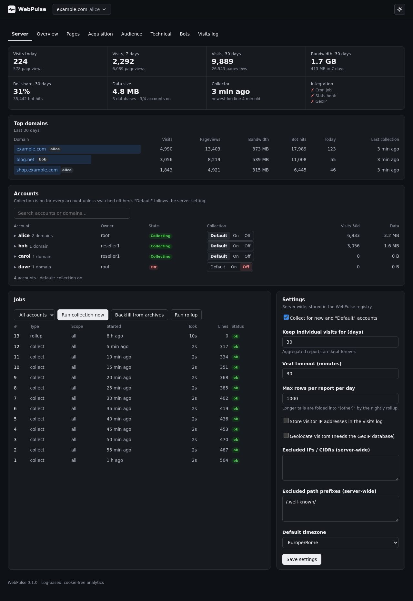

# WebPulse

**Lightweight, log-based web analytics for cPanel & WHM.**

WebPulse reads the access logs that Apache or Nginx already write for every domain on a cPanel
server and turns them into a modern, privacy-friendly dashboard. There is no JavaScript tracker
on your customers' sites, no cookie, no external service and nothing to install beyond one static
binary (SQLite is built in). Account owners get a *WebPulse Analytics* icon in cPanel; the server
administrator gets a WHM plugin to switch collection on and off per account or domain.

[](https://github.com/inalto/webpulse/actions/workflows/ci.yml)
[](LICENSE)
[](https://www.rust-lang.org/)


## Highlights

- **cPanel plugin.** Every account owner sees a dashboard for each of their domains (cPanel » Metrics).
- **WHM plugin.** The administrator sees a server-wide overview, switches collection per account and
  per domain, edits the settings and starts collect, backfill and rollup jobs.
- **No tracker, no cookies.** Everything comes from the access logs. IP addresses are hashed with a
  salt that changes every day and are not stored by default.
- **Survives log rotation.** Logs are read from a checkpoint (inode and offset). A cPanel hook drains
  them right before `cpanellogd` truncates them, so nothing is lost.
- **One SQLite file per domain.** Daily aggregates are kept forever. Individual visits are kept for a
  configurable number of days (30 by default).
- **Useful reports.** Visits and pageviews with period comparison, hour-by-weekday heatmap,
  acquisition channels, search engines, campaigns (UTM), countries, devices, browsers, entry and exit
  pages with bounce rate, 404s with their referrers, 5xx errors, bandwidth by file type, downloads,
  crawler share (AI crawlers highlighted) and a visits log.
- **Small and fast.** One static binary of a few megabytes, no interpreter, no `memory_limit` or
  `max_execution_time` surprises. The collector reads about 150 000 log lines per second of CPU time
  with a peak of 28 MiB on the development machine, about 5× the 30 000 lines/s of the 0.1.0 PHP
  engine (see [How it works](#how-it-works)).
- **Light and dark theme**, works on a phone.



> **Status.** WebPulse 0.2.0 is a rewrite of the 0.1.0 PHP code in Rust (same data, same dashboard;
> see [docs/RUST-PORT.md](docs/RUST-PORT.md)), and it was developed **without access to a real
> cPanel server**. The engine, the API and the dashboard are covered by an automated test suite
> that runs against a fake server root, and a parity harness compares its results with the 0.1.0 engine. The cPanel-specific steps (`install_plugin`,
> `register_appconfig`, `manage_hooks`, the Jupiter icon) follow the cPanel developer documentation
> but still need to be verified on a real server. Try it on a test server first and
> [report what you find](https://github.com/inalto/webpulse/issues).

## Installation

### Requirements

- A server running **cPanel & WHM** with the **Jupiter** theme and Apache (EasyApache 4) or ea-nginx.
  The documentation targets cPanel 110 or later on AlmaLinux, Rocky Linux, CloudLinux or Ubuntu.
  The installer does not check the cPanel version.
- **Root** access, on **Linux x86_64 or aarch64**.
- **No PHP, no Rust, no SQLite to install.** WebPulse is one statically linked binary
  (`/usr/local/webpulse/bin/webpulse`) that contains the collector, the CLI, the JSON API, the
  dashboard and the CGI entry points. The only PHP involved is cPanel's own
  (`/usr/local/cpanel/3rdparty/bin/php`), which runs the two tiny LiveAPI shims that every cPanel
  plugin page needs; the WHM side and the command line do not use PHP at all.
- Per-domain access logs in the **combined** format (the cPanel default).
- `curl` or `wget`, `tar`, `sha256sum` and the usual core tools. Outbound HTTPS to `github.com` (and
  to `download.db-ip.com` if you want GeoIP).
- Only for `--build`: the Rust toolchain (`cargo`, see [rustup.rs](https://rustup.rs)).

### One-line install

Run as root:

```bash
curl -fsSL https://raw.githubusercontent.com/inalto/webpulse/main/install.sh | bash
```

To pass flags, add `bash -s --`:

```bash
curl -fsSL https://raw.githubusercontent.com/inalto/webpulse/main/install.sh | bash -s -- --geoip
```

If you prefer to read the script before running it:

```bash
curl -fsSLO https://raw.githubusercontent.com/inalto/webpulse/main/install.sh
less install.sh
bash install.sh --geoip
```

The installer downloads the **release for your CPU** (`webpulse-<version>-x86_64-unknown-linux-musl.tar.gz`
or `...-aarch64-unknown-linux-musl.tar.gz`) from GitHub and verifies its sha256 checksum before it
touches anything. From an unpacked release tarball, `bash install.sh` installs the files it sits next to.
When stdin is not a terminal (as with `curl | bash`) the installer does not ask for confirmation.

**Air-gapped server, or your own build?** Download `webpulse-<version>-<arch>-linux-musl.tar.gz` and its
`.sha256` on another machine, copy the tarball over, unpack it and run `./install.sh`; or install any
binary you built with `./install.sh --binary /path/to/webpulse`. **No release for your platform, or you
want to build it yourself?** `install.sh --build` downloads the source and runs `cargo build --release`
(needs `cargo`).

### Installer options

| Flag | Meaning |
|------|---------|
| `--geoip` | Enable GeoIP and download the free DB-IP country database. A failed download is only a warning; retry with `webpulse geoip-update`. |
| `--ref <tag>` | Install this release (`v0.2.0` or `0.2.0`). Default `main`, which means *the latest release* (env `WEBPULSE_REF`). A branch name builds from source and needs `cargo`. |
| `--repo <owner/name>` | Install from this GitHub repository, for example a fork. Default `inalto/webpulse` (env `WEBPULSE_REPO`). |
| `--build` | Do not download a binary: fetch the source of `--ref` and run `cargo build --release --locked`. Fails with a clear message when `cargo` is missing. Also the automatic fallback when a release has no binary for your architecture and `cargo` is installed. |
| `--binary <file>` | Install this WebPulse binary instead of the release's (air-gapped installs, custom builds). |
| `--no-cron` | Do not install `/etc/cron.d/webpulse`. You must then schedule `webpulse collect` yourself. |
| `--update` | Update an existing installation in place. Safe to repeat. |
| `--uninstall` | Remove plugins, hooks, cron and code. Keeps `/var/webpulse` and `/etc/webpulse`. |
| `--purge` | With `--uninstall`: also delete `/var/webpulse` (all statistics) and `/etc/webpulse`. |
| `--standalone` | No cPanel: install only the CLI and the dev server. |
| `--all-themes` | Install the cPanel plugin into every directory under `/usr/local/cpanel/base/frontend/`. By default it is installed into every theme that has a `dynamicui.conf` (Jupiter, Meridian). |
| `--theme <name>` | Also install the cPanel plugin into this theme (repeatable). |
| `-y`, `--yes` | Do not ask for confirmation (implied when stdin is not a terminal). |
| `-h`, `--help` | Print the options. |

### What the installer does

1. Checks that it runs as root and that `/usr/local/cpanel/cpanel` exists (unless `--standalone`).
2. Gets the release: detects `uname -m` (`x86_64` or `aarch64`), resolves the latest release (or the
   `--ref` tag) through the GitHub API, downloads `webpulse-<version>-<target>.tar.gz` and its
   `.sha256`, **verifies the checksum** and unpacks it. Without a binary for that ref/architecture it
   builds from source when `cargo` is present (`--build` forces this) and otherwise stops with
   instructions. `--binary <file>` skips the binary download.
3. Copies the release to `/usr/local/webpulse-releases/<version>/` (`bin/webpulse` mode 0755), checks
   that the binary runs on this machine and runs `webpulse setup`. That creates
   `/etc/webpulse/config.json`, `/var/webpulse/` and the registry database.
4. Points `/usr/local/webpulse` at the new release with an atomic symlink swap. The last three releases
   are kept.
5. Copies the two LiveAPI shims into `/usr/local/cpanel/base/frontend/jupiter/webpulse/` and registers
   the plugin with `install_plugin` (Metrics group, feature `webpulse`).
6. Copies the WHM CGI shims and icon and registers them with `register_appconfig`. It restarts
   `cpsrvd` only if the registration asks for it.
7. Registers two Standardized Hooks with `manage_hooks` (`Stats::RunAll` and `Stats::RunUser`, stage
   `pre`) and creates `/var/webpulse/run/hook` (mode 1777).
8. Writes `/etc/cron.d/webpulse`, optionally sets up GeoIP, starts a first `webpulse collect` in the
   background and prints the URLs.

If a registration step fails, the installer prints the exact command and its output, undoes what
this run did (an update goes back to the previous release) and exits. A checksum mismatch stops
the installer before anything is changed.

Where things end up:

| What | Path |
|------|------|
| Code | `/usr/local/webpulse` (symlink to `/usr/local/webpulse-releases/<version>`); the program is `bin/webpulse` |
| Configuration | `/etc/webpulse/config.json` (mode 0600) |
| Statistics | `/var/webpulse/` (`webpulse.db`, `data/<user>/<domain>.db`, `geoip/`, `log/`, `run/`) |
| cPanel plugin | `/usr/local/cpanel/base/frontend/jupiter/webpulse/` (PHP shims only) |
| WHM plugin | `/usr/local/cpanel/whostmgr/docroot/cgi/webpulse/` (bash shims), `.../addon_plugins/webpulse.png`, `/var/cpanel/apps/webpulse.conf` |
| Cron | `/etc/cron.d/webpulse` |

### First steps after installing

**In WHM (administrator).**

1. Open **WHM » Plugins » WebPulse Analytics** (or `https://<server>:2087/cgi/webpulse/index.cgi`).
2. In the **Server** tab check the *Integration* tile: *Cron job* and *Stats hook* should show a tick.
3. Under **Accounts**, review which accounts collect data. New and *Default* accounts follow the server
   setting, which is **on** by default. Use the *Default / On / Off* switch to change an account or one
   of its domains.
4. Press **Run collection now** if you do not want to wait for cron. To import older history, pick an
   account and press **Backfill from archives**.

**In cPanel (account owner).**

1. Open **cPanel » Metrics » WebPulse Analytics**.
2. If the icon is missing, grant the `webpulse` feature to the account's feature list in
   **WHM » Feature Manager** ("WebPulse Analytics").
3. A domain shows *Collecting…* until its first log lines have been processed. Data usually appears
   within five minutes.

From a shell you can check the collector at any time:

```bash
/usr/local/webpulse/bin/webpulse status
```

### Updating

```bash
curl -fsSL https://raw.githubusercontent.com/inalto/webpulse/main/install.sh | bash -s -- --update
```

A new release is staged, the schema is migrated, the symlink is swapped and the plugin files are
refreshed. Configuration and statistics are not modified. If the update fails half-way, the previous
release is restored. Running `--update` twice is harmless.

### Uninstalling

```bash
/usr/local/webpulse/uninstall.sh             # remove plugins, hooks, cron and code; keep the statistics
/usr/local/webpulse/uninstall.sh --purge     # also delete /var/webpulse and /etc/webpulse
```

Without a local copy:

```bash
curl -fsSL https://raw.githubusercontent.com/inalto/webpulse/main/install.sh | bash -s -- --uninstall
```

Installing again later picks up the data that was kept.

### Manual installation

For locked-down servers, every command the installer runs is listed in the wiki:
[Manual Installation](https://github.com/inalto/webpulse/wiki/Manual-Installation) (also in
[docs/INSTALL.md](docs/INSTALL.md)).

## Quick tour of the dashboard

The header has a domain picker, date range buttons (today, yesterday, 7 days, 30 days, this month, last
month, 12 months, custom), a **Compare** switch and a light/dark toggle. Below it come eight KPI tiles
(visits, unique visitors, pageviews, pages per visit, average duration, bounce rate, bandwidth, bot
share) and one main chart. Then the tabs:

| Tab | What it shows |
|-----|---------------|
| **Server** (WHM only) | Server totals, top domains, collector health, accounts with On/Off switches, jobs, settings. |
| **Overview** | When people visit (heatmap), top pages, channels, top referrers, countries, devices, engagement. |
| **Pages** | Top pages, entry pages with bounce rate, exit pages with exit rate, downloads. |
| **Acquisition** | Channels over time, referrer hosts and URLs, search engines, keywords, campaigns, source / medium. |
| **Audience** | Countries, cities, browsers, operating systems, device types, engagement histograms. |
| **Technical** | HTTP status, 4xx and 5xx trends, top 404s with their referrers, server errors, bandwidth by file type, heaviest static files, HTTP vs HTTPS, peak hour. |
| **Bots** | Bot share over time, top crawlers, AI crawlers highlighted. |
| **Visits log** | Individual visits with country, device, channel, duration and the pages viewed. |
| **Settings** (cPanel only) | Per-domain timezone, excluded IPs and paths, dashboard preferences. |

Every table can be exported as CSV. More in the wiki:
[Using the Dashboard](https://github.com/inalto/webpulse/wiki/Using-the-Dashboard).

## Command line

```
webpulse collect [--user U [--domain D]] [--hooked]   tail the logs and update the statistics (cron runs this)
webpulse backfill --user U [--domain D]               import /home/U/logs/*.gz archives, never twice
webpulse rollup [--user U [--domain D]]               nightly compaction, retention, vacuum
webpulse status [--json]                              collection health
webpulse accounts list|enable|disable|reset [USER]    switch collection per account
webpulse domains  list|enable|disable|reset USER [DOMAIN]
webpulse report --user U --domain D [--range 30d] [--name DIMENSION] [--compare] [--json]
webpulse config get|set|unset KEY [VALUE]             run-time settings (also editable in WHM)
webpulse purge --user U [--domain D] --yes            delete statistics (irreversible)
webpulse geoip-update [--force]                       download the DB-IP country database
webpulse setup [--no-sync]                            create config, directories and registry (idempotent)
webpulse hooked                                       same as collect --hooked
webpulse serve --user U | --admin | --reseller NAME   local dev dashboard on 127.0.0.1 (no cPanel needed)
```

Every command accepts `--config <file>`, `--verbose`, `--quiet`, `--json` and `--help`.
`webpulse --version` prints the version. Exit codes: 0 success, 1 error, 2 usage error.
Details and examples: [Command Line](https://github.com/inalto/webpulse/wiki/Command-Line).

## Configuration

The file is `/etc/webpulse/config.json` (mode 0600). Values marked *editable* can also be changed in
**WHM » WebPulse Analytics » Server » Settings** or with `webpulse config set`. Those changes are stored
in the registry and win over the file.

| Key | Default | Meaning |
|-----|---------|---------|
| `default_enabled` | `true` | Collect for accounts that have no explicit On/Off switch. *Editable.* |
| `timezone` | `null` | Time zone for days and hours. `null` uses the server's. *Editable.* |
| `raw_retention_days` | `30` | Days to keep individual visits and events (1 to 3650). Aggregates are kept forever. *Editable.* |
| `max_rows_per_dim` | `1000` | Rows kept per report per day; the tail is folded into `(other)` by the nightly rollup (10 to 100000). *Editable.* |
| `session_timeout_min` | `30` | Minutes of inactivity that end a visit (5 to 240). *Editable.* |
| `store_ip` | `false` | Store the visitor IP in the visits log. Off by default. *Editable.* |
| `exclude_ips` | `[]` | IPs and CIDR ranges that are not counted. *Editable.* |
| `exclude_paths` | `/.well-known/`, `/cpanel`, `/whm`, `/webmail`, `/cgi-sys/` | Path prefixes that are not counted. *Editable.* |
| `count_head_requests` | `false` | Count `HEAD` and `OPTIONS` requests. *Editable.* |
| `max_open_visits` | `50000` | Visits a domain keeps open in memory while collecting; beyond it the oldest are closed early (bounds memory under a flood of distinct visitors). Built-in default, not in the shipped file. |
| `static_prefixes` | WordPress paths (see [Configuration](https://github.com/inalto/webpulse/wiki/Configuration)) | Path prefixes treated as static files. Built-in default, not in the shipped file. *Editable.* |
| `geoip.enabled` | `false` | Look up the country of each visit. *Editable.* |
| `geoip.country_db` | `/var/webpulse/geoip/dbip-country-lite.mmdb` | Country database (`.mmdb`). |
| `geoip.city_db` | `null` | Optional city database (`.mmdb`). |
| `php_bin` | `null` | Obsolete since 0.2.0 (the program no longer uses PHP). Ignored; kept so old configuration files stay valid. |
| `paths.data_dir` | `/var/webpulse/data` | Per-domain databases. |
| `paths.registry_db` | `/var/webpulse/webpulse.db` | Registry database. |
| `paths.log_dir` | `/var/webpulse/log` | `webpulse.log`. |
| `paths.run_dir` | `/var/webpulse/run` | Locks and hook flags. |
| `paths.domlogs_dirs` | Apache and Nginx domlog directories | Where to look for access logs; `{user}` is replaced. |
| `paths.archive_dir` | `/home/{user}/logs` | Archived `.gz` logs used by backfill. |
| `paths.userdomains_file` | `/etc/userdomains` | Domain to account map. |
| `paths.cpanel_users_dir` | `/var/cpanel/users` | cPanel account files. |
| `paths.home_root` | `/home` | Home directories. |

Account owners can set their own timezone, excluded IPs and excluded paths per domain in the cPanel
Settings tab. Full reference: [Configuration](https://github.com/inalto/webpulse/wiki/Configuration).

## Privacy

- IP addresses are **not stored**. Each visitor is identified by a hash of the IP address and user agent
  with a random salt that changes every day. Salts older than two days are deleted, so a visitor cannot
  be recognised from one day to the next.
- No cookies, no fingerprinting script, no data sent to a third party.
- The visits log keeps individual visits for `raw_retention_days` (30 by default). Aggregates contain no
  personal data.
- The administrator can switch `store_ip` on. Only then is the IP address written, and only to the
  visits log.
- Whether this satisfies GDPR for your use is your decision; see the wiki page
  [Privacy and GDPR](https://github.com/inalto/webpulse/wiki/Privacy-and-GDPR) for what is stored and
  how to purge an account.

## How it works

Every five minutes, and again right before cPanel's own `cpanellogd` statistics run (through the
`Stats::RunAll` and `Stats::RunUser` hooks), the collector reads each enabled domain's access log from
its last checkpoint. It parses the *combined* log lines, classifies each hit (pageview, static file,
download, redirect, error, bot), groups human hits into visits with a 30-minute timeout, and updates
the daily aggregates plus a short-lived visits log in the domain's SQLite database. The dashboards only
read those databases. A nightly rollup applies retention. Details:
[docs/ARCHITECTURE.md](docs/ARCHITECTURE.md) and the wiki page
[How It Works](https://github.com/inalto/webpulse/wiki/How-It-Works).

**Architecture in one paragraph.** Everything is the single Rust binary `webpulse`: the collector and
rollup (cron), the CLI, the JSON API, the page renderer, a local dev server and the `webpulse cgi`
entry point. The dashboard JavaScript and CSS (`ui/`) are embedded in it. cPanel requires
`*.live.php` pages to be PHP (or Perl) to use its `CPANEL` class, so `index.live.php` and `api.live.php`
are thin shims: they resolve the account from the cPanel session and run
`webpulse cgi --principal user:<account>` as that account, forwarding the CGI variables and the
request body. The WHM `index.cgi` and `api.cgi` are bash shims that `exec webpulse cgi --whm`.
The two hooks are shell scripts.

## Documentation

Wiki: <https://github.com/inalto/webpulse/wiki>

| Document | Content |
|----------|---------|
| [docs/ARCHITECTURE.md](docs/ARCHITECTURE.md) | Components, data flow, paths, security model |
| [docs/DATA-MODEL.md](docs/DATA-MODEL.md) | SQLite schemas |
| [docs/METRICS.md](docs/METRICS.md) | Exact definitions of visit, pageview, bounce, bot and the rest |
| [docs/API.md](docs/API.md) | JSON API used by the dashboards |
| [docs/DASHBOARD.md](docs/DASHBOARD.md) | Every report and graph, and why it is there |
| [docs/CPANEL-INTEGRATION.md](docs/CPANEL-INTEGRATION.md) | Plugin registration, hooks, log locations |
| [docs/INSTALL.md](docs/INSTALL.md) | Installation, manual installation, building from source, release layout, update, uninstall, troubleshooting |
| [docs/DEVELOPMENT.md](docs/DEVELOPMENT.md) | Cargo workflow, make targets, tests, parity harness, releases |
| [docs/RUST-PORT.md](docs/RUST-PORT.md) | The 0.2.0 rewrite in Rust: layout, compatibility contract, `webpulse cgi` |
| [docs/IMPLEMENTATION-PLAN.md](docs/IMPLEMENTATION-PLAN.md) | Work packages and contracts of the first (0.1.0, PHP) implementation; historical |
| [CHANGELOG.md](CHANGELOG.md) | Release notes |

## Contributing and development

Nothing here needs cPanel. You need a Rust toolchain (stable). PHP is optional: the tests run the two
cPanel shims with it (skipped without it), and the parity harness compares with the 0.1.0 PHP release.

```bash
make build          # cargo build --release  ->  target/release/webpulse
make test           # cargo test (engine, web and packaging tests) and the parity harness
make lint           # cargo fmt --check, clippy -D warnings, shellcheck
make serve          # collect sample logs and serve the dashboard on 127.0.0.1:8099 as account "alice"
make serve-admin    # same, with the WHM administrator view
make dist           # source tarball dist/webpulse-<version>.tar.gz
make release        # binary tarball dist/webpulse-<version>-<target>.tar.gz (+ .sha256)
```

`make serve` prints the URL to open; it contains a random token the dev server requires.
Read [docs/DEVELOPMENT.md](docs/DEVELOPMENT.md) first. CI runs `cargo fmt --check`,
`cargo clippy -D warnings`, `cargo test --release` (packaging tests included), the parity harness and
shellcheck; pushing a `v*` tag builds the static x86_64 and aarch64 binaries and publishes the release.

## License

MIT. See [LICENSE](LICENSE).
